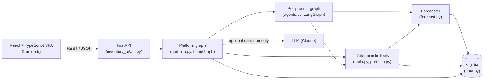
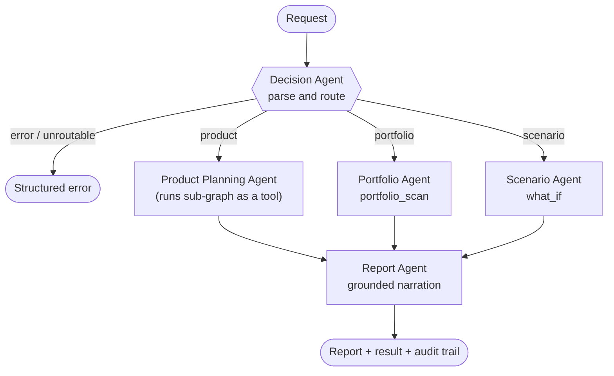
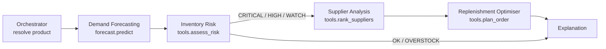

<div align="center">

# Stockline
### AI Inventory Intelligence & Autonomous Replenishment Platform

*Demand forecasting, stock-risk detection, supplier comparison and replenishment planning, coordinated by a team of tool-using agents with a full audit trail.*


**FAST National University of Computer and Emerging Sciences (NUCES), Karachi**
Department of Artificial Intelligence · BS AI Engineering

</div>

---

## Team

| Name | Student ID | Role |
|---|---|---|
| Hamza Sheikh | 23K-0060 | Team Lead |
| Areeba Hasnain | 23K-0059 | Team Member |
| Emman Abrar | 23K-0051 | Team Member |

**Submitted for:** AI Engineering and Agentic AI (a single project that satisfies both courses).

> ⚠️ **All data in this repository is simulated.** No real sales, stock or supplier records are used. The system supports planning decisions only: it **never places purchase orders** or connects to live supplier systems.

---

## Table of Contents

1. [Overview](#1-overview)
2. [Problem Statement and Objectives](#2-problem-statement-and-objectives)
3. [Key Features](#3-key-features)
4. [System Architecture](#4-system-architecture)
5. [The Agentic Layer](#5-the-agentic-layer)
6. [Machine Learning Pipeline](#6-machine-learning-pipeline)
7. [Decision Logic (Deterministic Tools)](#7-decision-logic-deterministic-tools)
8. [Data Layer and Simulated Dataset](#8-data-layer-and-simulated-dataset)
9. [REST API Reference](#9-rest-api-reference)
10. [Frontend](#10-frontend)
11. [Repository Structure](#11-repository-structure)
12. [Installation and Running](#12-installation-and-running)
13. [Configuration](#13-configuration)
14. [Example Interactions](#14-example-interactions)
15. [Testing](#15-testing)
16. [Evaluation and Reproducibility](#16-evaluation-and-reproducibility)
17. [Course Requirements Mapping](#17-course-requirements-mapping)
18. [Alignment with the Original Proposal](#18-alignment-with-the-original-proposal)
19. [Design Decisions and Trade-offs](#19-design-decisions-and-trade-offs)
20. [Responsible AI, Ethics and AI-Usage Declaration](#20-responsible-ai-ethics-and-ai-usage-declaration)
21. [Limitations](#21-limitations)
22. [Future Work](#22-future-work)
23. [Troubleshooting](#23-troubleshooting)

---

## 1. Overview

Stockline is an end-to-end inventory planning platform. A planner can select a product or ask a plain-language question such as *"Which products are at risk and how much should I spend with an $8k budget?"* and receive:

- a **28-day demand forecast** with an uncertainty band,
- a **stock-out risk assessment** (probability of running out before a new order can arrive),
- a **supplier comparison** (price, lead time, reliability, minimum order quantity),
- a **recommended order quantity and timing** with a confidence level,
- a short **explanation**, and
- an **audit trail** showing which agent called which tool, why, and how long it took.

The system is built around one rule: **every number comes from a verified, deterministic tool or model.** Agents decide *what to run and in what order*; an optional LLM may only *narrate* results, and its text is rejected if it contains any number that does not appear in the tool output.

---

## 2. Problem Statement and Objectives

Stock shortages lose sales; excess stock ties up capital. Planners often decide with limited visibility of future demand, and information about stock, demand and suppliers lives in separate places.

Stockline brings these together into one workflow. The objectives, carried over from the project proposal and extended for the agentic course, are:

| # | Objective | Where it is delivered |
|---|---|---|
| 1 | Explore historical sales to understand demand patterns | Seasonal, weekly, trend and promotion structure in the simulated data; holdout charts in the UI |
| 2 | Compare approaches for estimating future demand | Gradient-boosting model vs three baselines, evaluated per SKU |
| 3 | Identify products facing shortage or excess | Risk levels: `CRITICAL`, `HIGH`, `WATCH`, `OK`, `OVERSTOCK` |
| 4 | Use stock and supplier data for replenishment planning | Order-up-to policy with safety stock, MOQ rounding and order timing |
| 5 | Compare supplier options on price, delivery time and constraints | Weighted supplier score with MOQ over-ordering penalty |
| 6 | Present findings through a clear interface | React + TypeScript web application |
| 7 *(added)* | Portfolio-level reasoning and what-if analysis | Portfolio Agent and Scenario Agent |
| 8 *(added)* | Transparent, auditable multi-agent decisions | Decision Agent routing and per-step audit trail |

---

## 3. Key Features

**Planning**
- Per-product plan: forecast, risk, supplier ranking, recommended order and explanation.
- Portfolio scan: all products at risk, ranked replenishment queue, total required spend.
- **Budget-constrained allocation:** orders are funded in priority order, in whole MOQ multiples, until the budget is exhausted; unfunded items are reported.
- **What-if scenarios:** demand change (e.g. +20%), lead-time change (e.g. +5 days), supplier unavailability, and budget caps, compared against the baseline.

**Agentic behaviour**
- A **Decision Agent** classifies each request and chooses which agents and tools are needed; unneeded work is skipped.
- A **risk gate** skips supplier analysis and optimisation for products that need no action.
- Typed shared state (LangGraph) and a complete audit trail for every request.

**ML and evaluation**
- Global gradient-boosting forecaster with leak-free lag features.
- Per-SKU MAE, RMSE, WAPE and bias; three baselines; an out-of-sample check of the 80% prediction interval.

**Engineering**
- Modular Python package, SQLite data layer, config via environment variables, structured logging.
- REST API with validated inputs, a typed React front end, and a 26-test suite.

---

## 4. System Architecture



**Layering principles**

| Layer | Modules | Responsibility |
|---|---|---|
| Presentation | `frontend/` | Rendering, user input, REST calls. Contains no business logic. |
| Service | `api.py` | Validation, HTTP errors, CORS, JSON serialisation. |
| Orchestration | `portfolio.py`, `agents.py` | Routing, shared state, tool invocation, audit trail. |
| Analytics | `tools.py`, `portfolio.py` | Pure functions: risk, supplier ranking, order policy, scenarios. |
| ML | `forecast.py` | Feature engineering, training, evaluation, prediction. |
| Data | `data.py`, SQLite | Simulated data generation and persistence. |
| Config | `config.py` | Constants and environment-driven settings. |

---

## 5. The Agentic Layer

### 5.1 Two cooperating LangGraph workflows



The **Product Planning Agent** invokes the original per-product graph as a single tool:



### 5.2 Agent roster

| Agent | Responsibility | Tools it calls |
|---|---|---|
| **Decision Agent** | Classifies the request (product / portfolio / scenario), extracts the SKU, budget and what-if modifiers, emits an explicit plan | `portfolio.parse_request` |
| **Orchestrator** | Resolves the product from a SKU or name inside the per-product graph | `resolve_product` |
| **Demand Forecasting Agent** | 28-day forecast with per-SKU uncertainty | `forecast.predict` |
| **Inventory Risk Agent** | Stock-out probability over lead time and risk level | `tools.assess_risk` |
| **Supplier Analysis Agent** | Ranks suppliers on cost, lead time, reliability and MOQ | `tools.rank_suppliers` |
| **Replenishment Optimisation Agent** | Order quantity, safety stock, reorder point and timing | `tools.plan_order` |
| **Portfolio Agent** | Scans every SKU, prioritises, allocates budget, totals spend | `portfolio.portfolio_scan` |
| **Scenario Agent** | Re-runs the tools under changed assumptions and diffs against baseline | `portfolio.what_if` |
| **Report / Explanation Agent** | Produces the briefing; verifies any LLM text against tool output | `portfolio.grounded` |

### 5.3 What makes this agentic rather than a pipeline

- **Dynamic routing.** The Decision Agent chooses a different agent set per request. A portfolio question never runs the per-product forecasting graph; a what-if goes straight to the Scenario Agent.
- **Conditional control flow inside agents.** Products with `OK` or `OVERSTOCK` status skip the supplier and optimisation agents.
- **Real tool use.** Each agent calls named functions; inputs and outputs are logged.
- **Shared structured state.** `State` and `PState` are typed dictionaries. The audit list uses a reducer (`operator.add`) so each agent appends its own entries.
- **Composition.** The platform graph calls the per-product graph as a tool, so graphs nest.
- **Failure handling.** Unknown products, invalid budgets and unroutable questions end the graph with a structured error rather than a guess.

### 5.4 Routing rules (deterministic)

Routing is rule-based by design so that decisions are reproducible and testable.

| Condition detected in the request | Intent |
|---|---|
| Any what-if modifier (demand %, lead-time days, unavailable supplier) | `scenario` |
| Otherwise, a known SKU or product name | `product` |
| Otherwise, portfolio vocabulary (*products, which, total, spend, budget, at risk, overstock …*) | `portfolio` |
| None of the above, unknown SKU, or negative budget | error |

Supported phrasing examples: `demand +20%`, `demand drops 10%`, `lead time +5 days`, `without Apex Supply`, `budget $8k`, `a $2,500 budget`.

### 5.5 Audit trail

Every request returns a list of steps. Each step records `agent`, `tool`, `input`, `output`, `reasoning` and `ms`. The trail is returned by the API, shown in the UI, and persisted in the `decisions` table.

### 5.6 Separation of deterministic tools and LLM reasoning

| Concern | Handled by |
|---|---|
| Forecasts, risk, quantities, timing, spend, scenario deltas | Deterministic code and the trained model |
| Choosing which agents run | Deterministic routing rules |
| Wording of the final briefing | Template by default; LLM optional |

If `ANTHROPIC_API_KEY` is set, the Report Agent may ask an LLM to narrate the verified facts. `portfolio.grounded()` extracts every number from the LLM text and checks it against the tool output (allowing percentage forms and rounding). If any number is not grounded, the LLM text is discarded and the template is used; the audit trail records which path was taken. This is covered by a unit test that injects a hallucinated number.

---

## 6. Machine Learning Pipeline

### 6.1 Model

| Item | Choice |
|---|---|
| Algorithm | `HistGradientBoostingRegressor` (scikit-learn) |
| Loss | Poisson (demand is non-negative count data) |
| Hyper-parameters | `max_iter=300`, `learning_rate=0.05`, `max_leaf_nodes=15`, fixed seed |
| Scope | One **global** model across all SKUs (`sku_code` as a feature) |
| Horizon | 28 days, **direct** multi-horizon (no recursive error accumulation) |

### 6.2 Features

| Feature | Description |
|---|---|
| `dow`, `month` | Calendar position |
| `doy_sin`, `doy_cos` | Yearly seasonality (cyclic encoding) |
| `promo` | Promotion flag (assumed 0 for future days) |
| `lag28`, `lag35` | Demand 28 and 35 days earlier |
| `roll28` | 28-day mean of demand, lagged by 28 days |
| `sku_code` | Product identity |

**Leakage prevention.** Every demand-derived feature is lagged by **at least 28 days**, so it is already known for any day inside a 28-day forecast horizon. A unit test confirms that changing demand at or after the forecast origin does not change the features.

### 6.3 Evaluation protocol

- **Holdout:** the last 56 days, evaluated as a rolling 28-day-ahead forecast.
- **Baselines:** (1) naive, demand 28 days ago; (2) 28-day moving average; (3) average of lag 28 and lag 35.
- **Metrics:** MAE, RMSE, WAPE (weighted absolute percentage error) and bias, reported globally and **per SKU**.
- **Uncertainty:** per-SKU residual standard deviation. Interval quality is checked out-of-sample: sigma is estimated on the first half of the holdout and the 80% interval coverage is measured on the second half.
- **Final model:** after evaluation, the model is refit on all available data.

In the reference run, per-SKU WAPE ranges from roughly 7% to 30%, with higher error for low-volume products where Poisson noise dominates. The model is tested to beat the naive baseline overall and on at least 8 of 12 SKUs. To see exact figures for your run, open the **Model evaluation** view or call `GET /metrics`.

---

## 7. Decision Logic (Deterministic Tools)

### 7.1 Stock-out risk (`tools.assess_risk`)

Demand over the supplier lead time `L` is approximated as Normal with mean from the forecast and variance combining forecast error and lead-time variability:

```
position   = on_hand + on_order
sd         = sqrt( sigma² · L + (mean_daily · lead_std)² )
P(stockout) = 1 − Φ( (position − Σ forecast[1..L]) / sd )
cover_days = position / mean_daily
```

| Level | Rule |
|---|---|
| `CRITICAL` | P(stock-out) ≥ 50% **or** cover < lead time |
| `HIGH` | P(stock-out) ≥ 20% |
| `WATCH` | P(stock-out) ≥ 5% **or** cover < lead time + 7 days |
| `OVERSTOCK` | cover > 90 days |
| `OK` | otherwise |

### 7.2 Supplier ranking (`tools.rank_suppliers`)

Each metric is min-max normalised across the available suppliers:

```
score = 0.4·(1 − price_n) + 0.3·(1 − lead_n) + 0.3·reliability_n
        − 0.1 · min(1, (order_qty − need) / need)        # MOQ over-ordering penalty
```

Order quantity is rounded up to a multiple of each supplier's MOQ, and total cost is reported. Weights are configurable in `config.py`.

### 7.3 Replenishment (`tools.plan_order`)

An order-up-to policy with a 7-day review period `R` and a 95% service level (`z ≈ 1.645`):

```
target       = Σ forecast[1..L+R] + z · sd(L+R)
reorder_pt   = Σ forecast[1..L]   + z · sd(L)
order_qty    = ceil( max(target − position, MOQ) / MOQ ) · MOQ     # if target > position
order timing = first day the projected position falls to the reorder point
confidence   = (1 − holdout WAPE) · (1 − min(0.5, forecast CV over L+R))
```

Actions are `ORDER_NOW`, `ORDER_SCHEDULED`, `HOLD` or `NO_SUPPLIER`.

### 7.4 Portfolio prioritisation and budget (`portfolio.portfolio_scan`)

Items needing orders are ranked by risk severity, then by stock-out probability, then by lowest cover. With a budget, each item in rank order receives the largest whole number of MOQ multiples it can afford; remaining items are flagged as not (fully) funded. This greedy rule is transparent and easy to audit, but is not an optimal knapsack.

### 7.5 Scenarios (`portfolio.what_if`)

The scenario tool scales the forecast (`demand_mult`), shifts lead times (`lead_add`), removes unavailable suppliers (`exclude`), applies an optional budget, and returns `baseline`, `projected` and `delta`. Removing every supplier yields `NO_SUPPLIER` rather than a fabricated order.

---

## 8. Data Layer and Simulated Dataset

All data is generated by `data.py` with a fixed seed (42) and a fixed "as-of" date (2026-11-21), so runs are reproducible.

| Table | Contents |
|---|---|
| `sales` | 900 days × 12 SKUs: `date, sku, units, promo` |
| `products` | `sku, name, category, unit_cost, on_hand, on_order` |
| `suppliers` | 3 suppliers per SKU: `unit_price, lead_days, lead_std, moq, reliability` |
| `meta` | `as_of` date |
| `decisions` | Persisted requests: `id, ts, sku, payload (JSON incl. audit trail)` |

**Demand generation:** base level × linear trend × yearly seasonality (SKU-specific amplitude and phase) × day-of-week factor, with random promotions (+40% on ~5% of days) and Poisson noise. Starting stock levels are set to deliberately produce a mix of critical, watch, healthy and overstocked products so that the agents have meaningful work to do.

| Category | Example products |
|---|---|
| Electronics | Wireless Mouse, USB-C Cable, Mechanical Keyboard, Laptop Stand, Phone Charger |
| Home | Desk Lamp, Water Bottle |
| Stationery | Notebook Pack, Gel Pens (12) |
| Furniture | Office Chair, Standing Desk |
| Accessories | Backpack |

---

## 9. REST API Reference

Base URL (default): `http://localhost:8000` · Interactive docs: `/docs` (OpenAPI/Swagger).

| Method | Endpoint | Purpose |
|---|---|---|
| GET | `/health` | Liveness check |
| GET | `/products` | Product catalogue with current stock |
| GET | `/forecast/{sku}` | 28-day forecast, sigma, holdout WAPE |
| POST | `/plan` | Per-product plan via the product graph |
| **POST** | **`/ask`** | **Natural-language or structured request routed by the Decision Agent** |
| GET | `/portfolio?budget=` | Portfolio scan with priorities and optional budget |
| POST | `/whatif` | Scenario analysis (demand, lead time, suppliers, budget) |
| GET | `/suppliers/{sku}` | Ranked supplier comparison |
| GET | `/metrics` | Global evaluation metrics and baselines |
| GET | `/metrics/{sku}` | Per-SKU metrics |
| GET | `/holdout/{sku}` | Holdout actuals vs predictions |
| GET | `/decisions?n=` | Recently persisted decisions |

Errors: `404` unknown SKU, `422` invalid input (negative budget, `demand_mult ≤ 0`, unroutable question), structured `detail` message.

**Example: natural-language request**

```bash
curl -X POST http://localhost:8000/ask \
  -H "Content-Type: application/json" \
  -d '{"question": "What if demand +20% and lead time +5 days for SKU-001?"}'
```

Response shape: `{ "intent", "plan", "result", "report", "audit" }`.

**Example: structured scenario**

```bash
curl -X POST http://localhost:8000/whatif \
  -H "Content-Type: application/json" \
  -d '{"sku": null, "budget": 8000, "demand_mult": 1.2, "lead_add": 5, "exclude": ["Apex Supply"]}'
```

---

## 10. Frontend

A separate **React + TypeScript** single-page application (Vite) that communicates with the backend **only through the REST API**. It has no runtime dependencies other than React; charts are small SVG components.

| View | Purpose |
|---|---|
| **Overview** | Summary figures, ranked replenishment queue, and an "Ask the planner" box |
| **Product planner** | Recommendation, key risk figures, history + 28-day forecast with 80% interval, supplier options, briefing, decision trace |
| **Portfolio risk** | All products, budget input, ordered vs funded quantities, unfunded items |
| **Suppliers** | Side-by-side supplier comparison with the recommended option highlighted |
| **What-if scenarios** | Demand / lead-time sliders, supplier availability, budget; baseline vs scenario vs change |
| **Model evaluation** | Model vs baselines, per-SKU metrics, interval coverage, actual-vs-forecast chart |
| **Agent audit trail** | Per-request agent/tool trace for the session, plus persisted decisions from SQLite |

Design: a light, restrained B2B SaaS layout (left navigation, dense tables, status pills for risk levels, a persistent *Simulated data* badge and an API connection indicator).

---

## 11. Repository Structure

```
inventory_ai_system/
├── README.md
├── requirements.txt
├── inventory_ai/                 # Python backend package
│   ├── config.py                 # constants + environment configuration, logging
│   ├── data.py                   # simulated data generator + SQLite access
│   ├── forecast.py               # features, training, evaluation, prediction
│   ├── tools.py                  # pure tools: risk, supplier ranking, order policy
│   ├── agents.py                 # per-product LangGraph workflow, bootstrap
│   ├── portfolio.py              # portfolio/scenario tools + Decision Agent graph
│   └── api.py                    # FastAPI application
├── frontend/                     # React + TypeScript client
│   ├── src/
│   │   ├── api.ts                # typed REST client
│   │   ├── ui.tsx                # shared components and SVG charts
│   │   ├── pages.tsx             # the seven views
│   │   ├── App.tsx               # shell, navigation, state
│   │   └── styles.css
│   ├── package.json
│   └── .env.example
├── tests/
│   ├── test_core.py              # forecasting, tools, per-product graph
│   └── test_platform.py          # routing, portfolio, scenarios, API, edge cases
├── data/                         # generated SQLite DB (git-ignored)
└── models/                       # trained model artefact (git-ignored)
```

---

## 12. Installation and Running

### Prerequisites

- Python **3.10+**
- Node.js **18+** and npm
- Internet access for `pip` / `npm` installs (no GPU required)

### 1. Backend

```bash
git clone <your-repository-url> inventory_ai_system
cd inventory_ai_system

python -m venv .venv
source .venv/bin/activate            # Windows: .venv\Scripts\activate
pip install -r requirements.txt

python -m inventory_ai.agents        # generates data, trains the model, prints metrics + a sample plan
uvicorn inventory_ai.api:app --reload
```

The API runs at `http://localhost:8000` (Swagger UI at `/docs`). Data and model are created automatically on first start if they do not exist.

### 2. Frontend

```bash
cd frontend
cp .env.example .env                 # sets VITE_API_URL=http://localhost:8000
npm install
npm run dev                          # http://localhost:5173
```

Production build: `npm run build` (type-checks with `tsc` and bundles with Vite).

### 3. Tests

```bash
python -m pytest -q
```

### Optional: LLM-written briefings

```bash
export ANTHROPIC_API_KEY=...         # optional; without it, template briefings are used
```

---

## 13. Configuration

| Variable | Default | Purpose |
|---|---|---|
| `INV_DB` | `data/inventory.db` | SQLite database path |
| `SERVICE_LEVEL` | `0.95` | Target cycle service level for safety stock |
| `LOG_LEVEL` | `INFO` | Python logging level |
| `ANTHROPIC_API_KEY` | *(unset)* | Enables optional LLM narration |
| `LLM_MODEL` | `claude-sonnet-4-6` | Model used for optional narration |
| `CORS_ORIGINS` | `http://localhost:5173,http://127.0.0.1:5173` | Allowed browser origins |
| `VITE_API_URL` | `http://localhost:8000` | API base URL used by the frontend |

Constants such as horizon (28), holdout (56 days), review period (7 days) and supplier weights live in `inventory_ai/config.py`.

---

## 14. Example Interactions

The following outputs are from the reference run with the default seed.

**Single product: "Should I reorder SKU-001?"**
Wireless Mouse is classified **CRITICAL**: about 4 days of cover against a 12-day lead time. The platform recommends **ordering 1,200 units from GlobalParts today** (estimated cost $13,464, high confidence). The audit trail shows the Decision Agent, Demand Forecasting, Inventory Risk, Supplier Analysis, Replenishment Optimisation and Explanation steps.

**Portfolio with a budget: "Which products are at risk with a $8k budget?"**
3 of 12 products are at risk (2 critical). Required spend is **$20,404**; with an $8,000 budget, **$7,999** is funded in priority order (Wireless Mouse, Phone Charger, USB-C Cable) and all three are reported as not fully funded. Standing Desk and Backpack are flagged as overstocked and not to be reordered. Only the Decision Agent, Portfolio Agent and Report Agent run; the per-product forecasting graph is skipped.

**Scenario: "What if demand +20% and lead time +5 days for SKU-001?"**
The Scenario Agent re-runs the tools: cover falls from 4.0 to 3.3 days and the recommended order rises from 1,200 to 1,800 units (about $20,196).

---

## 15. Testing

26 automated tests (`pytest` counts each parametrised case) cover:

| Area | What is verified |
|---|---|
| **Forecast leakage** | Features at a given date are unaffected by future demand; horizon features are always available |
| **Model quality** | Model beats the naive baseline overall and on ≥ 8 of 12 SKUs; per-SKU metrics and baselines present |
| **Tool outputs** | MOQ rounding, `HOLD` when stock is ample, supplier ordering by score, output shapes |
| **Agent routing** | Portfolio requests skip the per-product graph; product requests run the full chain; low-risk products skip supplier/optimiser; scenario requests go only to the Scenario Agent |
| **Scenario analysis** | Higher demand or longer lead time is never "safer"; supplier exclusion respected; all suppliers removed gives `NO_SUPPLIER` |
| **Budget logic** | Funded spend never exceeds budget; zero budget funds nothing; priorities are contiguous and ordered |
| **LLM safety** | Ungrounded numbers in narrated text are rejected |
| **Parsing** | Demand/lead/budget/supplier phrasing variants |
| **API** | All major endpoints, 404/422 handling, CORS preflight |
| **Edge cases** | Empty question, unknown SKU, negative budget, unroutable text |

---

## 16. Evaluation and Reproducibility

- **Deterministic data:** fixed seed and as-of date.
- **Deterministic model:** fixed random state; metrics are stored with the model artefact and exposed via `/metrics`.
- **Deterministic routing:** rule-based, so the same request produces the same plan.
- **Honest evaluation:** time-based holdout (no shuffling), lagged features, and out-of-sample interval-coverage testing.
- **Self-healing bootstrap:** the API and CLI regenerate data and retrain if the database or model is missing or outdated.

Minor numeric differences may occur across scikit-learn versions or platforms.

---

## 17. Course Requirements Mapping

### 17.1 Agentic AI

| Requirement | Implementation |
|---|---|
| Multiple specialised agents | Decision, Forecasting, Risk, Supplier, Optimiser, Portfolio, Scenario, Report/Explanation |
| Tool use | Named tools invoked by each agent with logged inputs and outputs |
| Shared state / memory | Typed LangGraph state (`State`, `PState`); decisions persisted in SQLite |
| Planning and orchestration | Decision Agent emits an explicit plan; nested graphs |
| Conditional routing / autonomy | Intent routing; risk-based gate inside the product graph |
| Collaboration toward one outcome | Agents' outputs combine into a single recommendation (quantity, supplier, timing, confidence) |
| Grounding and safety | Numeric guard on LLM text; no purchase orders; error paths for invalid input |
| Observability | Full per-step audit trail in API, UI and database |

### 17.2 AI Engineering

| Requirement | Implementation |
|---|---|
| Data pipeline | Seeded generator → SQLite → feature builder |
| ML model development | Global gradient boosting with Poisson loss, direct 28-day horizon |
| Model evaluation | Time-based holdout, three baselines, per-SKU MAE/RMSE/WAPE/bias, interval coverage |
| Leakage control | ≥ 28-day lags, covered by tests |
| Modularity | Separate data, ML, tools, orchestration, API and UI layers |
| APIs | FastAPI with validated schemas and clear error codes |
| Testing | 26 tests across unit, integration and API levels |
| Configuration | Environment variables and a central config module |
| Logging and error handling | Python `logging`; graph failures caught and returned as structured errors |
| Reproducibility | Fixed seeds, pinned as-of date, one-command setup |
| Front end | Typed React client consuming the REST API |

---

## 18. Alignment with the Original Proposal

The proposal, *AI-Powered Inventory and Demand Planner*, defined six objectives and left the exact methods open to be decided after data exploration. This project delivers each of them and extends the scope:

| Proposal item | Status |
|---|---|
| Explore historical sales for patterns and trends | Delivered (structured simulated data, holdout charts) |
| Compare approaches for demand estimation | Delivered (model vs three baselines, per SKU) |
| Identify stock-shortage and excess-inventory products | Delivered (`CRITICAL` … `OVERSTOCK`) |
| Support replenishment planning | Delivered (order-up-to policy, MOQ, timing) |
| Compare suppliers on price, delivery time, order constraints | Delivered (weighted score with MOQ penalty) |
| Present results in an accessible interface | Delivered (React + TypeScript SPA) |
| Simulated data clearly labelled where real data is unavailable | Delivered (UI badge, README, code comments) |
| No real purchase orders or live supplier integration | Respected |
| **Extensions for the Agentic AI course** | Decision Agent, Portfolio Agent, Scenario Agent, audit trail, grounded narration |

---

## 19. Design Decisions and Trade-offs

| Decision | Rationale | Trade-off |
|---|---|---|
| Gradient boosting instead of deep learning | Strong on tabular data, fast to train, easy to explain and reproduce | Less expressive for very long-range patterns |
| Global model across SKUs | Shares seasonal structure and helps low-volume items | May under-fit very SKU-specific behaviour |
| Direct 28-day horizon with lagged features | No compounding recursive error; leak-free by construction | Horizon capped at 28 days |
| Normal approximation for uncertainty | Simple, transparent, testable | Imperfect for low-count demand |
| Rule-based routing | Auditable, reproducible, testable; no LLM latency or cost | Unusual phrasing is rejected with a helpful error |
| LLM only narrates and is verified | Prevents hallucinated numbers in decisions | Narration is plainer when no LLM key is set |
| Greedy budget allocation | Transparent and explainable by priority | Not guaranteed optimal |
| SQLite | Zero-setup, adequate for a prototype | Not for concurrent multi-user production use |
| No chart or router library in the UI | Small bundle, fewer dependencies | Less interactivity than a charting library |

---

## 20. Responsible AI, Ethics and AI-Usage Declaration

- **Simulated data** is labelled as such everywhere it is shown.
- **Decision support only.** The system never places orders or contacts suppliers; a human remains responsible for decisions.
- **Transparency.** Every recommendation can be traced to the agents, tools and inputs that produced it.
- **Grounded language.** Numbers in narrated text must match tool output or the text is discarded.
- **Known limits** of the forecasting and risk methods are documented below.
- **Declaration of AI usage.** AI-based tools were used to support parts of this work, such as drafting, coding assistance and debugging. All outputs were reviewed and verified by the team, and the system's behaviour is validated by the automated test suite.

---

## 21. Limitations

- Data is simulated; real-world demand has intermittency, stock-outs that censor sales, price effects and supply disruptions that are not modelled.
- Uncertainty uses a Normal approximation and constant per-SKU sigma.
- The 28-day horizon means lead time plus review period is clipped to the forecast window.
- Suppliers and prices are static; no price breaks, partial deliveries or multi-sourcing.
- Budget allocation is greedy, not optimal; scenarios are evaluated one at a time.
- Request parsing is rule-based and English-only.
- The frontend has no authentication, pagination or automated UI tests, and is optimised for desktop.
- The product chart shows only the last 42 days of history because the API exposes holdout data rather than the full sales series.
- SQLite is suitable for a prototype, not for concurrent production workloads.

---

## 22. Future Work

- Connect to real ERP/POS data and handle intermittent demand and censored sales.
- Quantile or conformal prediction intervals instead of Normal approximation.
- Optimal budget allocation (integer programming) and multi-supplier order splitting.
- A `/sales/{sku}` endpoint for full history charts; explicit forecast-vs-actual drift monitoring.
- Optional LLM-assisted intent classification, still validated by the deterministic router.
- Human-in-the-loop approval workflow and role-based access control.
- Dockerised deployment and CI running tests and the frontend build.
- PostgreSQL for multi-user deployments.

---

## 23. Troubleshooting

| Symptom | Likely cause and fix |
|---|---|
| UI shows "API offline" | Start the backend: `uvicorn inventory_ai.api:app --reload`; check `VITE_API_URL` |
| Browser CORS error | Add your frontend origin to `CORS_ORIGINS` and restart the API |
| `ModuleNotFoundError: inventory_ai` | Run commands from the repository root (`python -m ...`, `uvicorn inventory_ai.api:app`) |
| Missing or stale model | Run `python -m inventory_ai.agents` to regenerate data and retrain |
| Syntax error on `str \| None` | Python 3.10+ is required |
| `pip` error about externally managed environment | Use a virtual environment (`python -m venv .venv`) |
| Request rejected with "Could not route the request" | Name a product (SKU or name), ask a portfolio question, or give a what-if such as "demand +20%" |

---

<div align="center">

**Stockline** · FAST-NUCES Karachi · BS AI Engineering
Areeba Hasnain (23K-0059) · Emman Abrar (23K-0051) · Hamza Sheikh (23K-0060)

*Developed for academic evaluation. All data is simulated.*

</div>
